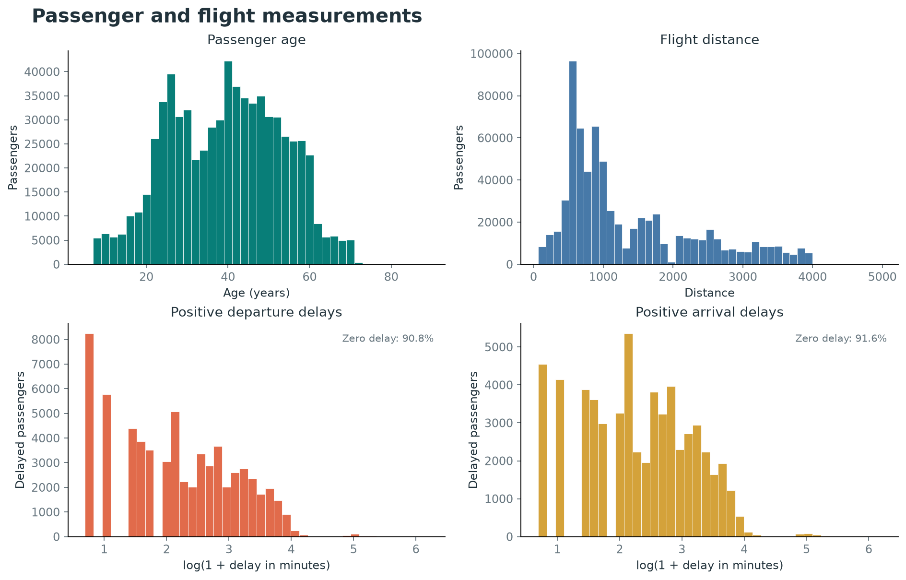
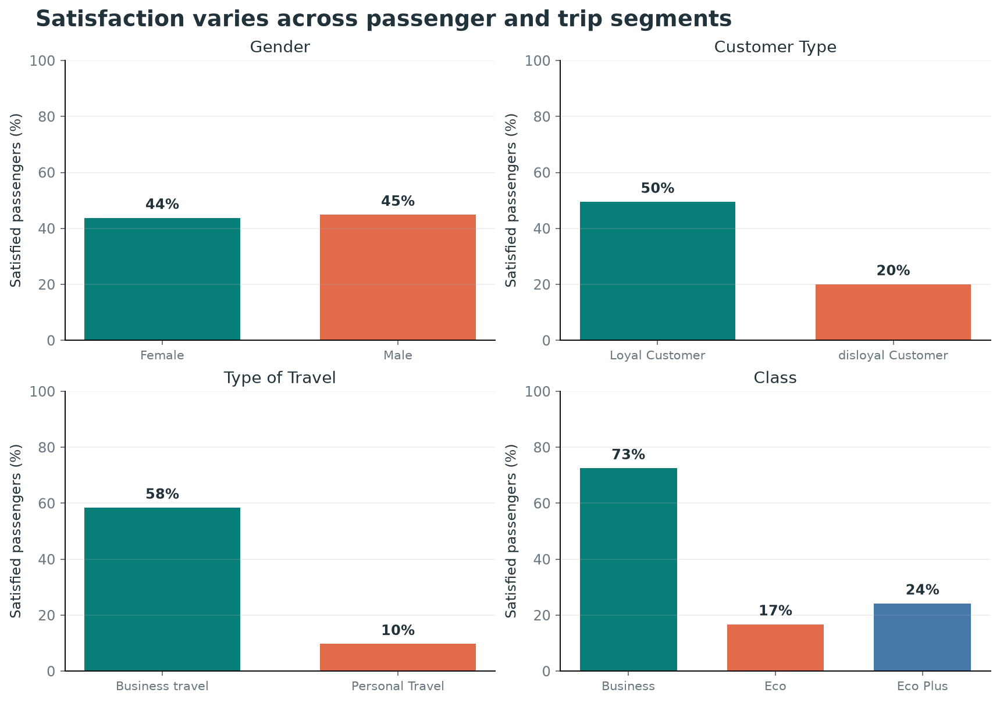
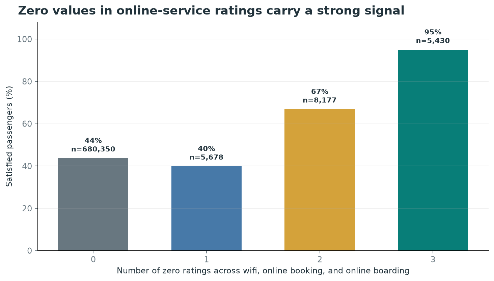

# Flight Satisfaction Prediction

This project explores passenger satisfaction in the Kaggle Playground Series S6E10 flight satisfaction competition. The notebook combines exploratory data analysis, leakage-aware feature engineering, neural-network experiments, boosted-tree models, probability blending, and competition submission generation.

## Project Files

- [`flight_mlp_v2.ipynb`](flight_mlp_v2.ipynb): the current end-to-end analysis and modeling notebook.
- [`DATA_INSIGHTS.md`](DATA_INSIGHTS.md): a compact record of the exploratory findings and earlier model-comparison results.
- [`kaggle/working/submission.csv`](kaggle/working/submission.csv): the output path used by the notebook for competition predictions. It is generated when the final notebook cell runs.
- [`pyproject.toml`](pyproject.toml): Python version and package dependency declarations.

## Exploratory Plots

These figures were generated from the labeled competition training data. They illustrate descriptive patterns, not causal effects.

### Numeric Features

Age and flight distance are shown on their original scales. Delay panels show positive delays on a `log1p` scale and report how many records have zero delay.



### Satisfaction by Segment

Business travel and Business class have higher satisfaction rates in this dataset; gender rates are similar.



### Online Rating Zeros

Satisfaction rate by the count of zero values across wifi, online booking, and online boarding ratings. Sample sizes are labeled above each bar.



## Setup and Run

The project declares Python `>=3.14` and uses `uv` for dependency management.

```bash
uv sync
uv run jupyter lab
```

Open `flight_mlp_v2.ipynb` and run the cells from top to bottom. The notebook downloads the competition files with `kagglehub`, so the Kaggle account used by KaggleHub must have access to `playground-series-s6e10`. The notebook expects the downloaded directory to contain `train.csv` and `test.csv`.

The final cell creates `kaggle/working/` if needed and writes a CSV with `id` and `satisfaction` columns to `kaggle/working/submission.csv`. The `satisfaction` values are rank-averaged model scores, not hard class labels.

## Notebook Workflow

### 1. Load data and reserve a holdout

The notebook imports pandas, NumPy, Matplotlib, Seaborn, and scikit-learn, downloads the competition data, and reads `train.csv`. It separates the target (`satisfaction`) from the predictors and creates a stratified 80/20 train/holdout split with `random_state=42`. The holdout is used for model evaluation; test data is loaded later for submission generation.

### 2. Explore the training data

The initial checks inspect dataset shape, target balance, missing values, column types, summary statistics, and feature distributions. The EDA focuses on numeric fields, ordinal service ratings, and nominal passenger/trip categories. It also compares satisfaction rates across feature values and segments, checks rating correlations, and investigates when rating values of zero occur.

The observations guide candidate transformations; they are not causal claims. The notebook avoids dropping plausible long-distance flights simply because an IQR rule flags them, and it treats delay outlier rules cautiously because the delay distributions are heavily concentrated at zero.

### 3. Prepare the MLP features

The `FlightFeatures` transformer is fitted within the scikit-learn pipeline so statistics used for imputation and rating fills come from the training fold only. It:

- Drops the identifier column.
- Fills missing arrival delays using departure delay plus the median arrival-minus-departure gap learned from the fit data, then clips the result at zero.
- Applies `log1p` to flight distance and departure/arrival delays.
- Converts age to bands and optionally adds flight-distance bands.
- Maps the nominal/binary fields to numeric values and keeps `Class` in its natural order.
- Replaces zero service ratings with the training median of the corresponding positive ratings, while retaining zero-related indicators (`online_zeros` and `dep_arr_zero`) when enabled.
- One-hot encodes age/distance/zero-count categories and standardizes continuous and rating features before fitting an `MLPClassifier`.

An ablation compares the v2 MLP with and without distance bands and zero-rating features on the same holdout split. A randomized search then tunes hidden-layer sizes, regularization (`alpha`), and learning rate using three-fold ROC-AUC on the training split.

### 4. Fit boosted-tree models

The tree feature builder keeps numeric values in their raw scale, maps nominal features, fills missing arrival delay from a gap calculated on training data, and adds zero-rating summaries, average/minimum service ratings, and travel/class and loyalty/travel interaction features. LightGBM receives a small randomized parameter search; LightGBM and CatBoost use an inner validation split drawn from the training data for early stopping. The reserved holdout is used only for their final AUC comparison.

### 5. Compare and blend predictions

The notebook measures holdout ROC-AUC for LightGBM, CatBoost, and a three-seed MLP ensemble. It also inspects prediction rank correlations and compares equal-probability blends with a rank-average blend. The final submission cell defaults to rank-averaging LightGBM, CatBoost, and MLP scores; the `chosen` list can be changed to select a different blend based on the preceding diagnostics.

## Findings from Data Exploration

These findings are summarized from [`DATA_INSIGHTS.md`](DATA_INSIGHTS.md) and the EDA notes in the notebook.

- **Age:** Mean is approximately 39 and median 40, with a range of 7-85. The distribution has concentrations around ages 25 and 39, and satisfaction varies non-linearly with age. Tree models can represent this directly; age bands are also explored for the MLP.
- **Flight distance:** Mean is approximately 1,354 and median 954, with a right-skewed, multi-peaked distribution. About 18,331 rows lie above the IQR upper bound, but these are plausible long-haul flights and should not be removed as presumed errors. The MLP tests log scaling and optional distance bands.
- **Delays:** Departure and arrival delay are strongly correlated (about 0.84), right-skewed, and concentrated at zero. Arrival delay has 227 missing values. Since the IQR is zero, an IQR rule is not useful for identifying invalid delays. The notebook imputes missing arrival delay from the training-set median delay gap and tests log-scaled delays for the MLP.
- **Service ratings:** Ratings are mostly on a 1-5 scale, but zero values occur in some rows. About 94% of rows have no zero ratings. Zeros in wifi, online booking, and online boarding often co-occur; the EDA suggests that zero may mean “not applicable” or “not rated,” rather than the lowest service score. The MLP therefore preserves zero information in separate features while replacing zero values in the scaled rating columns with training-set positive-rating medians.
- **Trip and passenger categories:** Business travel and Business class have substantially higher satisfaction rates than personal travel and economy classes. Loyal customers also have higher satisfaction than disloyal customers. Gender shows little difference in the exploratory summaries.

## Interpreting Results

`DATA_INSIGHTS.md` records scores from an earlier model-comparison run: full-data cross-validation ROC-AUC values of 0.9567 for MLP, 0.9540 for Random Forest, and 0.9468 for LightGBM; holdout ROC-AUC values of 0.9561 for MLP, 0.9531 for Random Forest, 0.9471 for a sampled RBF SVM, and 0.9458 for LightGBM. The SVM used only a sample and is not directly comparable to the full-data runs. The earlier MLP also had convergence warnings at 60 iterations.

These are reference results, not results verified by the current `flight_mlp_v2.ipynb`: the current notebook has no saved execution outputs and follows a revised MLP plus LightGBM/CatBoost blending workflow. Run it from top to bottom to produce current ablation, tuning, holdout, blend, and submission results. Its one-seed holdout comparisons are useful for iteration, but repeated or nested validation would be needed for stronger model-selection estimates.

## Current Limitations and Next Experiments

- The notebook is exploratory and currently has no saved execution outputs; reported output depends on rerunning it with the competition data and required packages available.
- Compare the engineered MLP representation with alternatives for rating values and zero handling; the current zero interpretation is supported by observed associations, not a confirmed data definition.
- Test delay-derived features and age/distance bin choices with validation rather than assuming they improve performance.
- Use repeated or nested validation and inspect calibration/log loss in addition to ROC-AUC before treating small score differences as robust.
- Check the notebook's holdout results and blend diagnostics before finalizing the `chosen` models used for the competition submission.
